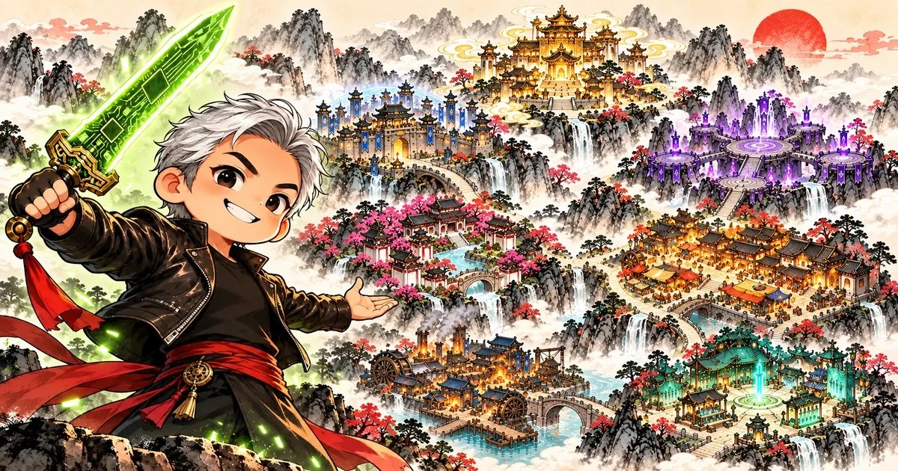

# AI

AI 學習作品集 · AI learning projects

---

## 🗡️ AI 群俠傳 · AI Wuxia Chronicles

用武俠漫畫看懂 NVIDIA GTC Berlin 主題演講裡的 AI 生態系：約 90 家公司與產業，每張卡都說人話、附 AI 新知與來源。

Meet the AI ecosystem from NVIDIA's GTC Berlin keynote through wuxia comics — about 90 companies and industries, in plain words, with sources.

**▶ 開始逛 / Visit：[繁體中文](https://sean-lee-software-embedded.github.io/AI/ai_game/) · [English](https://sean-lee-software-embedded.github.io/AI/ai_game/en/)**

- 🗺️ 江湖地圖：CSPs、AI Labs、AI Natives、Neoclouds、ODM & OEM、OpenShell、Enterprise & Industrial
- ⚔️ 比武問答、📚 AI 辭典、📜 收集秘笈冊
- 🦆 彩蛋「盟主馴鴨記」：GTC 台上的 Microduck 機器鴨、十二堂必修，和站長在 NVIDIA Brev 上的實測訓練影片 → [直接看彩蛋](https://sean-lee-software-embedded.github.io/AI/ai_game/#/duck)

⭐ **喜歡的話，按右上角的 Star**——不用錢，卻能讓更多人看到。
If you enjoyed it, a ⭐ Star (top right) helps more people find it.

個人學習用途，非 NVIDIA 或任何公司官方網站，與各公司無合作或背書關係；公司名稱與 Logo 為各自商標，僅用於辨識；不構成投資建議。 A personal, fan-made learning project — not affiliated with or endorsed by NVIDIA or any listed company; names and logos are trademarks of their owners; not investment advice.
